# AETHER Complete Project Flowchart

This document maps the complete AETHER system: startup, request handling, authentication, rate limiting, inference, resilience, scheduling, persistence, metrics, and deployment.

## 1. Complete system overview

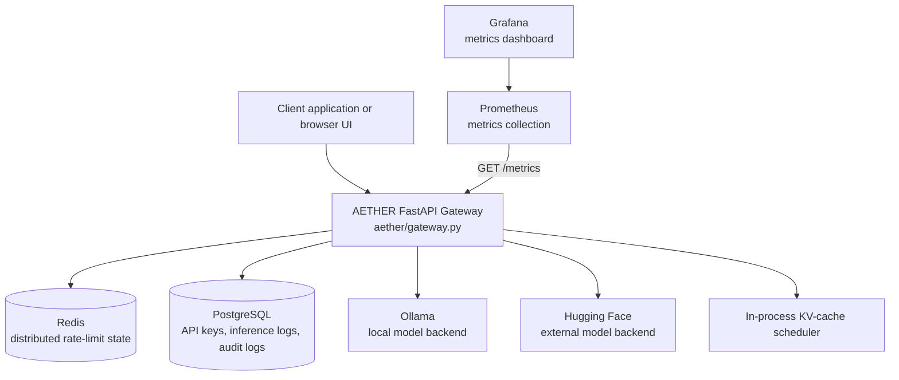

## 2. Startup and application lifecycle

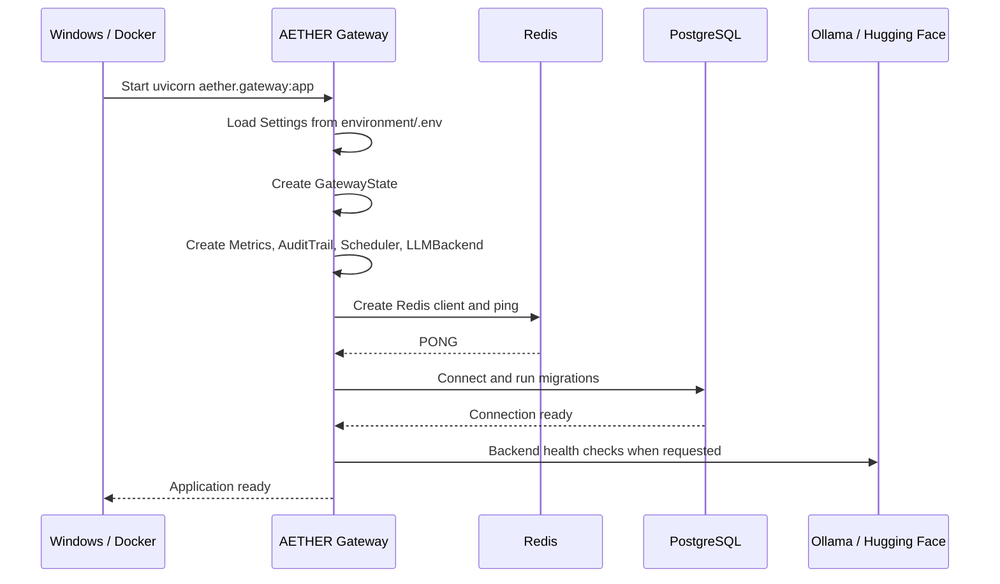

If PostgreSQL is unavailable, the gateway can still start using `API_KEYS`, but database-backed API-key management returns `503`.

## 3. Normal request flow

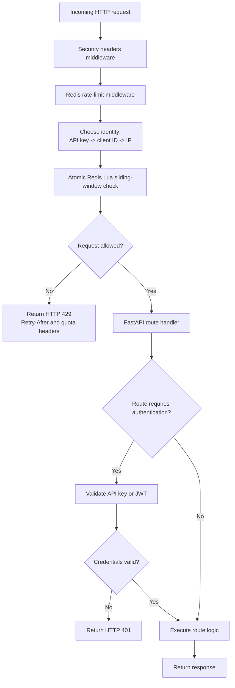

## 4. Rate-limiting flow

```mermaid
flowchart TD
    Request[Incoming request]
    Key[Build Redis key:\naether:rate-limit:{identity}:{route}]
    Remove[Remove entries older than window]
    Count[Count current requests]
    Full{Count >= limit?}
    Denied[Return 429\nRetry-After header]
    Add[Add request to Redis sorted set]
    TTL[Set Redis key expiration]
    Continue[Continue to FastAPI route]
    RedisError{Redis error?}
    FailClosed[Return 503\nrate limiter unavailable]
    FailOpen[Continue without limit\nonly if configured]

    Request --> Key
    Key --> RedisError
    RedisError -->|Yes| FailClosed
    RedisError -->|Yes and fail-open| FailOpen
    RedisError -->|No| Remove --> Count --> Full
    Full -->|Yes| Denied
    Full -->|No| Add --> TTL --> Continue
```

The rate limiter is distributed because all gateway instances use the same Redis keys.

## 5. Authentication flow

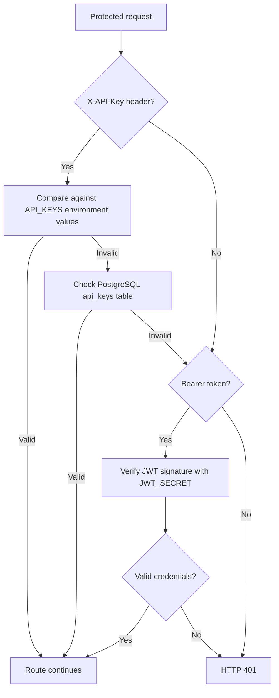

JWT verification exists, but the project does not currently issue JWTs. API keys are the practical authentication method.

## 6. Synchronous inference flow

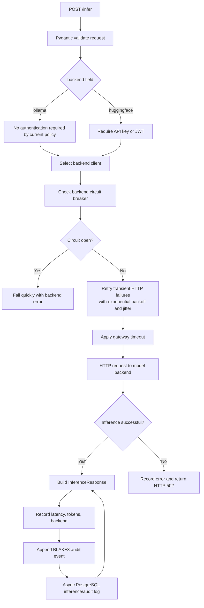

## 7. Ollama inference flow

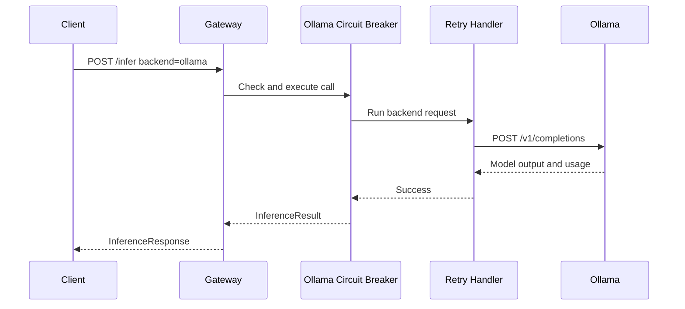

## 8. Hugging Face inference flow

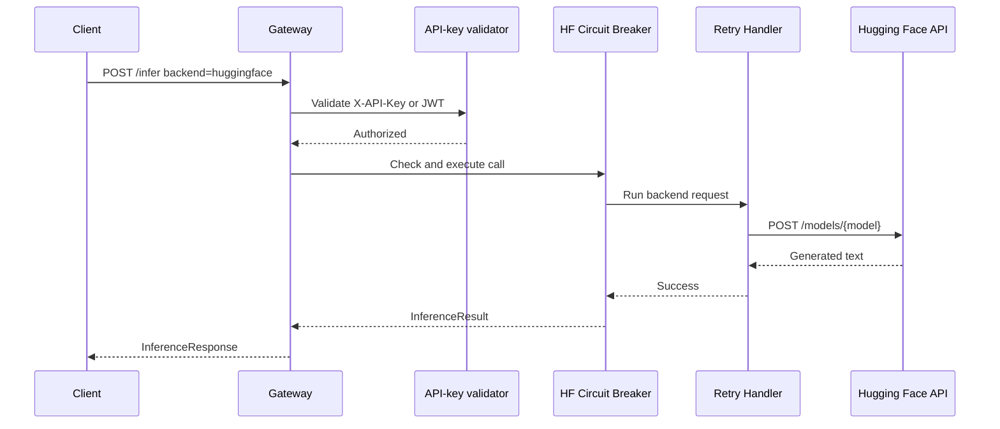

## 9. Streaming flow

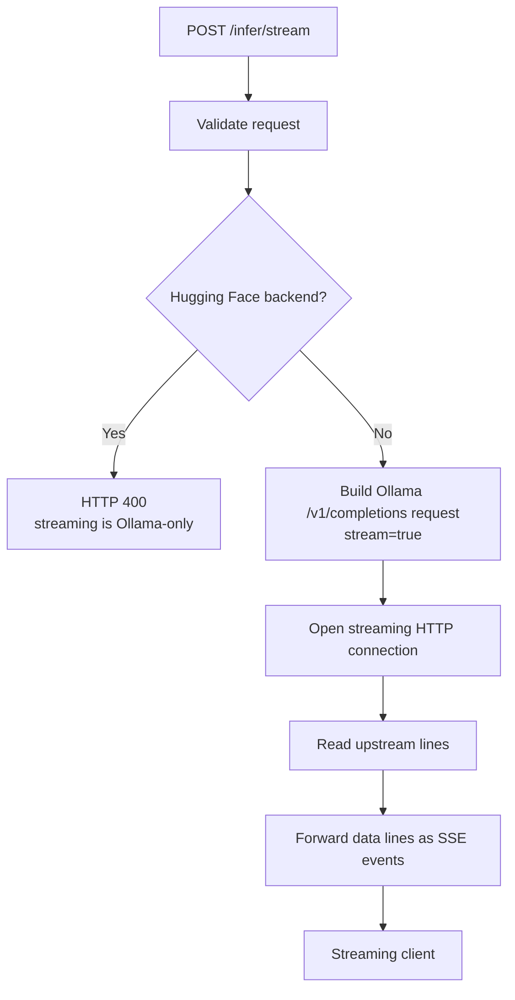

## 10. OpenAI-compatible chat flow

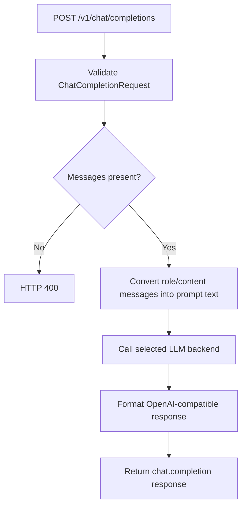

## 11. KV-cache scheduler flow

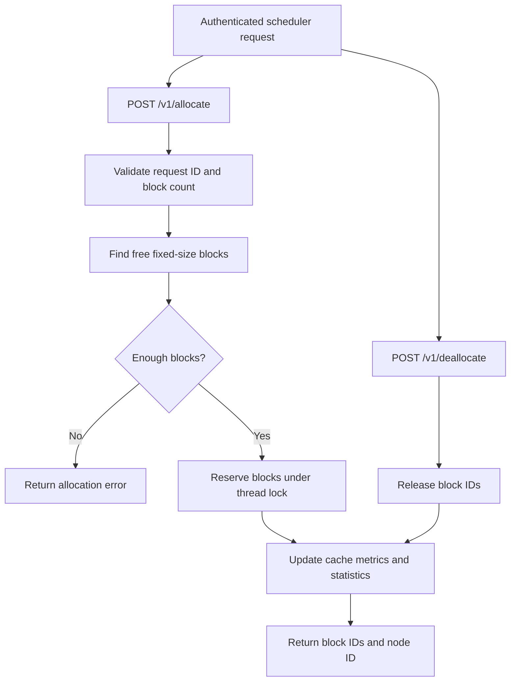

The scheduler is single-process and in-memory. It is not a distributed multi-machine cache allocator.

## 12. API-key management flow

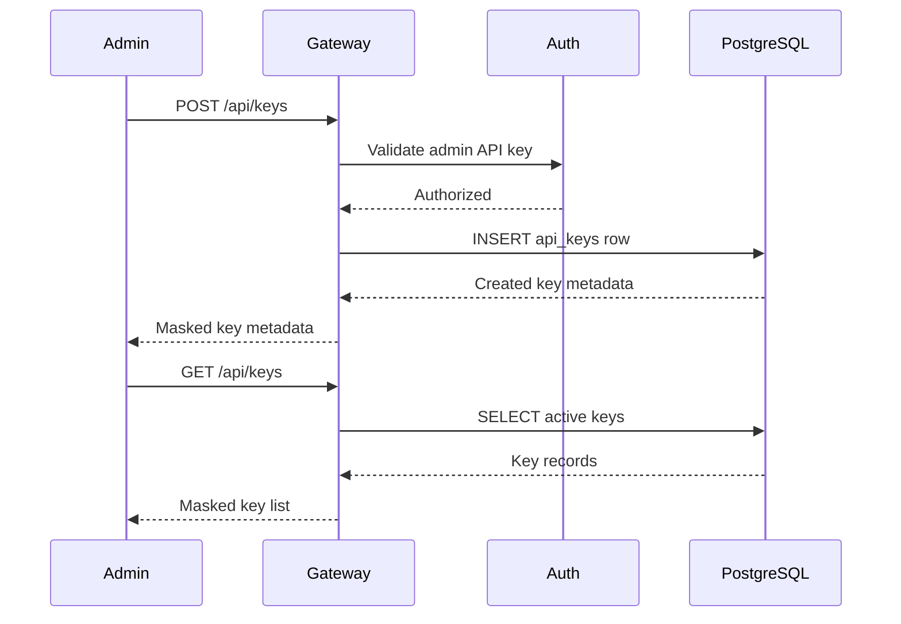

## 13. PostgreSQL data flow

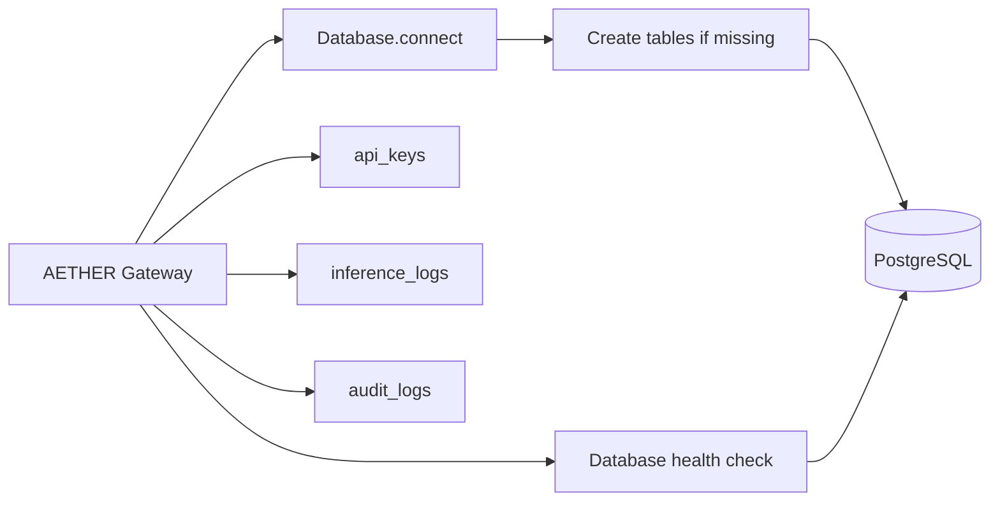

## 14. Monitoring flow

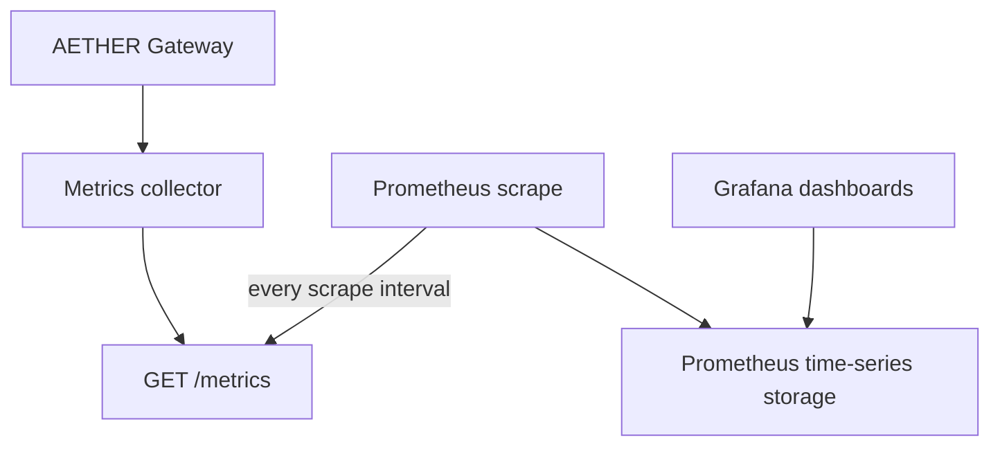

Metrics include inference totals, latency, generated tokens, errors, rate-limited requests, and allocated cache blocks.

## 15. Docker deployment flow

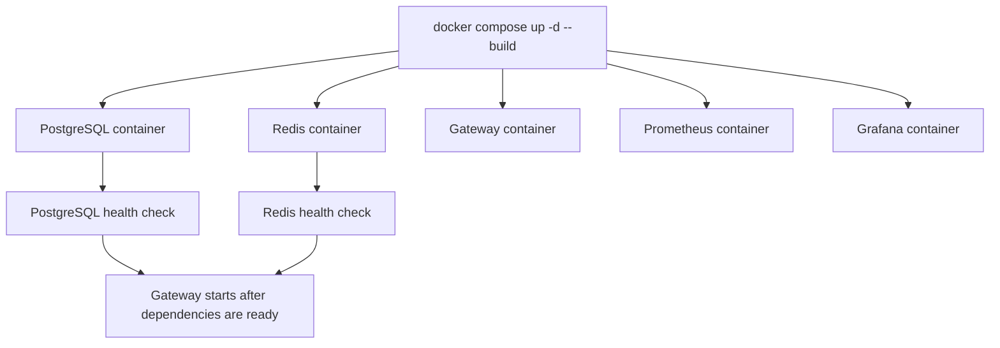

The gateway container uses `host.docker.internal` for Ollama running on the Windows host. PostgreSQL and Redis are reached by their Compose service names.

## 16. Endpoint map

| Endpoint | Purpose | Auth | Main dependencies |
|---|---|---:|---|
| `GET /` | Local web UI | No | Static HTML |
| `POST /infer` | Synchronous inference | HF only | Ollama or Hugging Face |
| `POST /infer/stream` | Ollama SSE streaming | HF rejected | Ollama |
| `POST /v1/chat/completions` | OpenAI-compatible chat | HF only | Ollama or Hugging Face |
| `POST /v1/allocate` | Allocate KV-cache blocks | Yes | In-process scheduler |
| `POST /v1/deallocate` | Release KV-cache blocks | Yes | In-process scheduler |
| `GET /v1/stats` | Scheduler statistics | Yes | In-process scheduler |
| `GET /v1/cluster` | Scheduler node health | Yes | In-process scheduler |
| `GET /backends/status` | Backend health and breakers | Yes | Ollama/Hugging Face |
| `POST /api/keys` | Create database API key | Yes | PostgreSQL |
| `GET /api/keys` | List database API keys | Yes | PostgreSQL |
| `DELETE /api/keys/{key}` | Revoke database API key | Yes | PostgreSQL |
| `GET /health/live` | Liveness | No | None |
| `GET /health/ready` | Backend readiness | No | Backend health |
| `GET /health` | Full health report | No | DB, backends, audit, scheduler |
| `GET /metrics` | Prometheus metrics | No | Metrics collector |

## 17. Main limitations

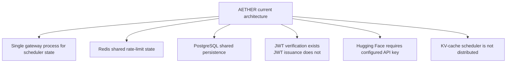

The production-grade rate limiter is distributed through Redis, while the KV-cache scheduler and audit trail remain process-local unless their persistence paths are explicitly used.
